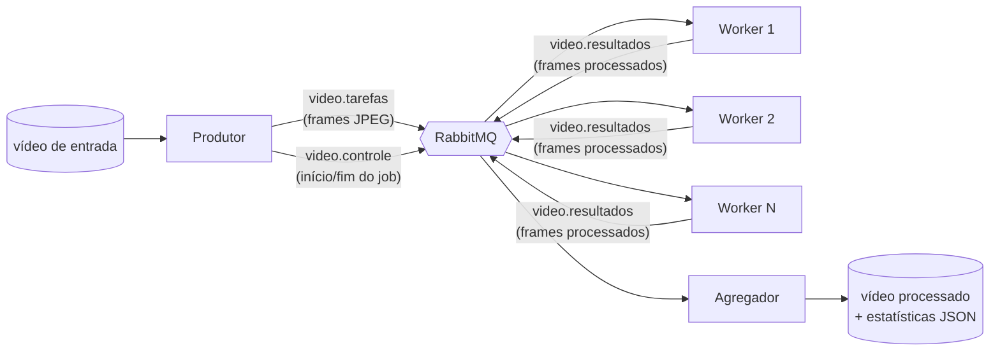

# Processamento Distribuído de Vídeo com RabbitMQ

## Integrantes

- Gustavo Argoze Lopes da Costa — 212070
- Victoria Mariucha Raulino de Araruna — 222666

## Resumo da solução

Aplicação distribuída que aplica filtros de visão computacional (OpenCV) em vídeos, dividindo o trabalho entre vários processos independentes que se comunicam por **mensageria AMQP (RabbitMQ)**.

O vídeo é quebrado em frames, e cada frame vira uma mensagem distribuída entre *N* workers. Os workers processam em paralelo e um agregador remonta o vídeo na ordem correta. O número de workers pode aumentar ou diminuir sem alteração de código (`--scale worker=N`). Para evidenciar o ganho de desempenho, o sistema mede o tempo total e quantos frames cada worker processou.

### Arquitetura



### Módulos (4)

| Módulo | Arquivo | Função |
|---|---|---|
| **Broker** | `rabbitmq` (imagem oficial) | Mantém as filas duráveis `video.tarefas`, `video.resultados` e `video.controle` e distribui as mensagens entre os consumidores. Os dados ficam num volume Docker e sobrevivem à recriação do container. |
| **Produtor** | `src/produtor.py` | Lê o vídeo e codifica cada frame em JPEG. Publica cada frame em `video.tarefas`, com os cabeçalhos `job_id`, `indice`, `filtro` e `fps`. Também envia as mensagens de início e fim do job (com o total de frames) em `video.controle`. |
| **Worker** (N instâncias) | `src/worker.py` | Consome `video.tarefas` com `prefetch=1`: cada worker só pega um novo frame quando termina o atual, o que equilibra a carga automaticamente. Aplica o filtro, publica o resultado em `video.resultados` e **só então confirma (ack)** a tarefa. |
| **Agregador** | `src/agregador.py` | Consome `video.resultados` e `video.controle`. Guarda em buffer os frames que chegam fora de ordem e escreve no vídeo de saída sempre que o próximo índice esperado está disponível. Ao final, grava o `.mp4` e um `_stats.json` com o tempo total, os frames por segundo e a distribuição de frames por worker. |

Módulos auxiliares:

- `src/filtros.py`: filtros disponíveis — `cinza`, `bordas`, `desfoque`, `cartoon`, `estilizar` e `rostos` (detecta e borra rostos). Os filtros `estilizar`, `cartoon` e `rostos` são os mais pesados e evidenciam melhor o ganho com vários workers.
- `src/comum.py`: configuração da conexão com o RabbitMQ e declaração das filas, compartilhadas pelos módulos.

### Aspectos de programação distribuída

- **Distribuição e balanceamento de carga:** fila de trabalho (*work queue*) com `prefetch=1`. Workers mais rápidos recebem mais frames.
- **Coordenação:** um protocolo de controle (`inicio`/`fim`) informa ao agregador o total de frames do job. Assim ele sabe quando o resultado está completo, mesmo com as mensagens chegando fora de ordem.
- **Tolerância a falhas:** o ack manual vem só depois de publicar o resultado. Se um worker cair no meio do processamento, o RabbitMQ devolve o frame à fila e outro worker o processa. O agregador ignora frames duplicados. Se a conexão com o broker cair, o Docker reinicia workers e agregador automaticamente (`restart: unless-stopped`).
- **Escalabilidade horizontal:** os workers não guardam estado, então basta subir mais réplicas.
- **Persistência:** filas duráveis, mensagens persistentes e dados do broker em volume Docker. Um job em andamento sobrevive a um reinício do RabbitMQ.

### Estrutura do projeto

```
proc-video-distribuido/
├── docs/README.md              # esta documentação
├── src/
│   ├── produtor.py             # módulo produtor
│   ├── worker.py               # módulo worker
│   ├── agregador.py            # módulo agregador
│   ├── filtros.py              # filtros OpenCV
│   └── comum.py                # conexão AMQP e nomes das filas
├── scripts/
│   ├── gerar_video_teste.py    # gera um vídeo sintético de teste
│   └── benchmark.sh            # compara o tempo com 1, 2 e 4 workers
├── data/
│   ├── input/                  # vídeos de entrada
│   └── output/                 # vídeos processados e estatísticas
├── Dockerfile
├── docker-compose.yml
└── requirements.txt
```

## Recursos utilizados

| Recurso | Versão |
|---|---|
| Python | 3.12 |
| RabbitMQ (AMQP 0-9-1) + management plugin | 3.13 |
| pika (cliente AMQP) | 1.3.2 |
| opencv-python-headless | 4.10.0.84 |
| numpy | 1.26.4 |
| Docker / Docker Compose | 24+ / v2 (no Windows: Docker Desktop com WSL 2) |

As bibliotecas Python não estão incluídas no projeto. Elas são instaladas na construção da imagem Docker a partir do `requirements.txt`.

## Compilação e deploy

Os comandos abaixo funcionam no PowerShell (Windows), no Linux e no macOS. Execute-os na pasta raiz do projeto.

### 1. Subir o sistema

```bash
docker compose up -d --build
```

Esse comando constrói a imagem e sobe o RabbitMQ, o agregador e 3 workers. Na primeira vez leva alguns minutos, porque baixa as imagens base.

### 2. Processar um vídeo

O projeto já inclui um vídeo de exemplo em `data/input/video.mp4` (veja a seção [Exemplo incluído](#exemplo-incluído)). Para processá-lo:

```bash
docker compose run --rm produtor --entrada /data/input/video.mp4 --filtro cartoon
```

- Para usar outro vídeo, copie-o para `data/input/` e informe o nome em `--entrada`. O caminho começa com `/data/` porque é o caminho dentro do container, onde a pasta `data/` do projeto é montada.
- Filtros disponíveis em `--filtro`: `cinza`, `bordas`, `desfoque`, `cartoon`, `estilizar` e `rostos`.
- Para gerar um vídeo sintético de teste: `python scripts/gerar_video_teste.py data/input/teste.mp4 --segundos 10` (requer `pip install opencv-python-headless`).

### 3. Acompanhar e ver o resultado

```bash
docker compose logs -f agregador worker
```

Quando o agregador exibir `JOB <id> CONCLUÍDO`, o resultado estará em:

- `data/output/<job_id>_<filtro>.mp4`: o vídeo processado (sem áudio).
- `data/output/<job_id>_stats.json`: o tempo total, os frames por segundo e os frames processados por worker.

Abra o vídeo somente depois do `CONCLUÍDO`: enquanto o job roda, o arquivo ainda está sendo escrito. O vídeo usa o codec MPEG-4 (`mp4v`). Se o player padrão do sistema não o reproduzir, use o VLC.

O painel do RabbitMQ fica em http://localhost:15672 (usuário `guest`, senha `guest`). Na aba *Queues and Streams* dá para ver as filas enchendo e esvaziando em tempo real.

### Escalar os workers

```bash
docker compose up -d --scale worker=6
```

### Testar a tolerância a falhas

Com um job em andamento, derrube um dos workers:

```bash
docker stop proc-video-distribuido-worker-1
```

O vídeo de saída continua sendo gerado completo. Os frames que esse worker não confirmou voltam para a fila e são processados pelos demais. Para ver os nomes dos containers, use `docker ps`.

### Comparar o desempenho com 1, 2 e 4 workers

Em Linux, macOS ou Git Bash:

```bash
./scripts/benchmark.sh data/input/video.mp4 cartoon
```

No PowerShell, faça manualmente: rode `docker compose up -d --scale worker=1`, processe o vídeo e anote o `tempo_total_s` do `_stats.json`. Depois repita com `--scale worker=4`.

### Encerrar

```bash
docker compose down          # para os containers
docker compose down -v       # para e também apaga as filas do RabbitMQ
```

### Execução sem Docker (opcional)

Requer um RabbitMQ acessível em `localhost:5672`.

```bash
pip install -r requirements.txt
cd src
python agregador.py          # terminal 1
python worker.py             # terminais 2, 3, 4... (um por worker)
python produtor.py --entrada ../data/input/video.mp4 --filtro cartoon
```

No modo local, defina a pasta de saída antes de iniciar o agregador:

- Linux/macOS: `PASTA_SAIDA=../data/output python agregador.py`
- PowerShell: `$env:PASTA_SAIDA="..\data\output"; python agregador.py`

### Variáveis de ambiente

| Variável | Padrão | Uso |
|---|---|---|
| `RABBITMQ_HOST` / `RABBITMQ_PORT` | `localhost` / `5672` | Endereço do broker |
| `RABBITMQ_USER` / `RABBITMQ_PASS` | `guest` / `guest` | Credenciais |
| `PASTA_SAIDA` | `/data/output` | Pasta onde o agregador grava o resultado |
| `WORKER_ID` | hostname | Identificação do worker nos logs e nas estatísticas |

## Exemplo incluído

Para facilitar a avaliação, o projeto acompanha um exemplo de antes e depois, sem que seja preciso executar nada:

- Entrada: `data/input/video.mp4`
- Saída (filtro `cartoon`): `data/output/video_cartoon.mp4`
- Estatísticas da execução: `data/output/video_cartoon_stats.json`

Para reprocessar o exemplo:

```bash
docker compose run --rm produtor --entrada /data/input/video.mp4 --filtro cartoon
```

## Vídeo de demonstração

[Link para o vídeo (< 5 min)](COLOCAR_LINK_AQUI)
